<p align="center">
  
</p>

<h1 align="center">Jellio for Android</h1>

<p align="center">
  The native Android phone and tablet client for Jellio, built with Kotlin,<br>
  Jetpack Compose, and Media3 ExoPlayer.
</p>

## Features

- **Adaptive mobile & tablet interface**: floating glassmorphic pill bottom
  navigation on phones in portrait, adaptive sidebar navigation on tablets and
  landscape screens, seasonal home screen effects, and guided onboarding.
- **Home, discovery & Studio Hubs**: hero showcase, Continue Watching, Next Up,
  weighted personal Top Picks, Because You Watched, Studio Hubs, infinite genre
  rows, Coming Soon calendar, customizable row layouts synced with your server,
  typo-tolerant fuzzy search, and rich TMDB actor and crew pages.
- **Video player & stream intelligence**: Media3 ExoPlayer with direct play and
  HLS, vertical swipe gestures for brightness and volume, double-tap seek,
  pinch-to-zoom and aspect ratio toggle, touch lock, screen rotation toggle,
  Picture-in-Picture with live transport controls, immersive edge-to-edge
  fullscreen, proactive stream warmup with `Ready` badges, automatic failover,
  multi-edition selector, subtitle sync, and multi-tier Skip Intro and Skip
  Credits.
- **Books, manga & language study**: dedicated Books, Audiobooks, and Manga
  shelves with synced custom categories; reflowable EPUB reader with inline
  images, Dark/Sepia/Light themes, typography controls, full-book search,
  5-color highlights, notes, and Android TextToSpeech read-aloud; native high-DPI
  PDF reader with pinch-to-zoom; CBZ and live Suwayomi manga reader with 5
  reading modes, scanlator filters, and tracker sync; inline Wiktionary and DeepL
  lookup with word chips and SM-2 spaced-repetition vocabulary flashcards.
- **Audiobook player & background service**: multi-track and single-file M4B
  playback, embedded chapter markers, chapter boundary tick marks and scrub
  preview, timestamp bookmarks, 0.75x to 2.0x playback speed, sleep timer with
  gradual 15-second audio fade-out, a persistent docked mini-player, and a native
  Android `MediaSessionService` for background notifications, lock-screen
  controls, and Bluetooth headset controls.
- **Offline downloads & progress sync**: full offline download manager for
  movies, episodes, books, manga chapters, and multi-track audiobooks with
  offline bookshelf browsing and automatic reading, listening, and playback
  progress replay on reconnect.
- **Live TV, Group Watch, Friends & Ani-Sync**: Live TV player with channel
  health badges and EPG guide, SyncPlay watch parties, Friends and shared
  watchlists, user profiles with achievement badges and activity feed, per-user
  two-way Ani-Sync (AniList, MyAnimeList, Shikimori, Simkl), localization in 7
  languages (English, German, Spanish, French, Italian, Polish, Portuguese), and
  much more.

## Install & Updates

1. Download the latest `.apk` from
   [GitHub Releases](https://github.com/NoahSKipp/Jellio-Android/releases/latest)
   on your Android phone or tablet and open it to install.
2. You also need a Jellyfin server running the
   [Jellio plugin](https://github.com/NoahSKipp/Jellio).
3. Enter your Jellyfin server address and sign in with your Jellyfin account.

Jellio for Android checks for new releases automatically and supports
signature-verified in-app updates from **Settings > About > Check for Updates**.

## Build from source

```bash
git clone https://github.com/NoahSKipp/Jellio-Android.git
cd Jellio-Android
./gradlew :app:assembleDebug
```

Development requires a JDK and the Android SDK.

## Credits

- UI/UX and architecture adapted from
  [Jellio](https://github.com/NoahSKipp/Jellio) and
  [Jellio TV](https://github.com/NoahSKipp/Jellio-TV), inspired by
  [NuvioTV](https://github.com/NuvioMedia/NuvioTV)
- Ani-Sync inspired by and adapted from
  [vosmiic/jellyfin-ani-sync](https://github.com/vosmiic/jellyfin-ani-sync)

## License

GNU General Public License v3.0